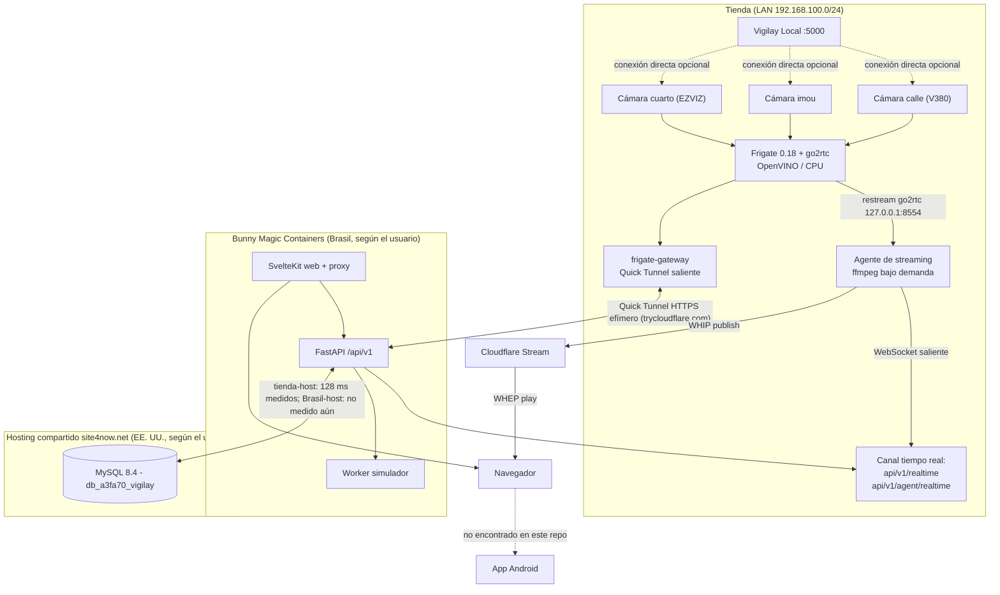
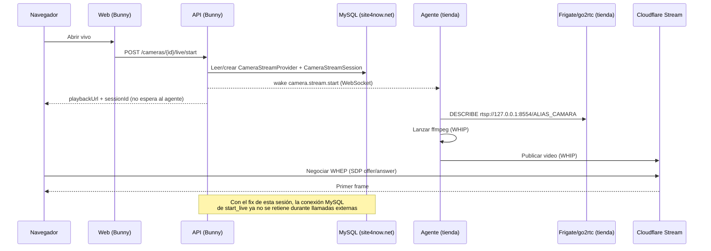
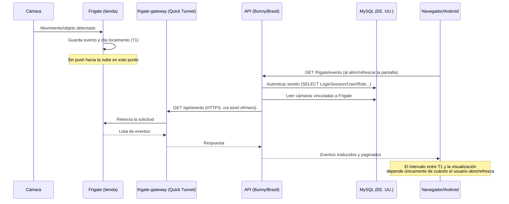

# Diagnóstico de rendimiento — Vigilay

Fecha: 15 de septiembre de 2026. Alcance: repositorio `camara_ia` (plataforma Vigilay), instalación real de la sede Cenfelec (tres cámaras: `calle`, `cuarto`, `imou`), configuración de Frigate en `F:\ia\frigate\config\config.yaml`, `.env` local y `docker-compose.yml`. Este documento distingue explícitamente cuatro tipos de afirmación:

- **DATO MEDIDO**: se ejecutó un comando de diagnóstico real durante esta inspección y aquí se reporta su resultado exacto.
- **DATO ENCONTRADO EN CONFIGURACIÓN/CÓDIGO**: valor o comportamiento leído directamente del repositorio, sin inferencia.
- **ESTIMACIÓN**: cálculo derivado de datos encontrados, con su fórmula explícita.
- **HIPÓTESIS**: explicación plausible que todavía no tiene medición directa que la confirme o descarte.

No se modificó Docker, Frigate ni MySQL como parte de este diagnóstico (dos hallazgos de sesiones de trabajo previas ya corregidas — el rol de audio de `cuarto` y la retención de conexiones MySQL durante llamadas a Frigate — se documentan aquí como antecedentes con su evidencia, no como cambios nuevos). No se exponen contraseñas, tokens ni claves; se usa `[REDACTED]`.

## 1. Resumen ejecutivo

1. El cuello de botella con más evidencia directa **no es MySQL en sí**, sino el **patrón de acceso**: cada request autenticado abre dos sesiones MySQL secuenciales, y hasta hace pocas horas varias rutas mantenían una de esas conexiones abierta mientras esperaban una respuesta HTTP de Frigate de hasta 10 s. Con un pool de 2 conexiones por proceso (impuesto por el plan de hosting), eso podía bloquear a *cualquier* otro usuario del sistema, no solo al que consultaba Frigate. **Ya corregido en este repositorio** (commit `7702092`), pendiente de estar activo en el despliegue de Brasil.
2. **MySQL está en un proveedor de hosting compartido** (`site4now.net`, resuelto por DNS/ping a una IP con ~128 ms de latencia desde la tienda) — DATO MEDIDO. Eso no prueba por sí solo que MySQL sea el problema (instrucción explícita del pedido), pero sí fija un piso de latencia de red que ningún índice ni caché puede evitar, y confirma límites de conexión estrictos (pool de 2, sin overflow) típicos de ese tipo de plan.
3. **El canal entre el backend de Brasil y Frigate en la tienda es un Cloudflare Quick Tunnel efímero**, documentado en el propio repositorio como solución temporal ("para producción se reemplaza el Quick Tunnel por un túnel administrado con dominio"). Todo el tráfico de eventos, miniaturas, clips y grabaciones pasa por ahí; no hay caché intermedia.
4. **No existe un servicio de notificaciones push** (no hay Firebase/FCM, ni cola, ni WebHook saliente) ni una app Android en este repositorio. Lo que la interfaz llama "eventos de IA" es una consulta bajo demanda a Frigate; no hay tabla de eventos en MySQL (confirmado en `docs/DATABASE.md`).
5. Se encontró y corrigió, con evidencia real de logs, una cámara (`cuarto`, EZVIZ) que reiniciaba su proceso de video cada ~30 segundos durante más de 9 horas por un rol de audio mal configurado en Frigate — 1115 reinicios medidos. No es un problema de Vigilay ni de red, pero explica cortes de video que fácilmente se perciben como "lentitud".
6. Se encontraron y detuvieron procesos redundantes en la máquina de la tienda (un prototipo heredado con más de 5 horas de CPU activo conectado simultáneamente a las tres cámaras, y agentes de streaming duplicados) que competían por las mismas conexiones RTSP que Frigate.
7. La latencia de la tienda hacia Cloudflare es excelente (~3 ms medidos), lo que hace **poco probable** que el enlace WebRTC en sí sea el limitante del video en vivo; el sospechoso más plausible para "lentitud en vivo" sigue siendo la cadena de arranque bajo demanda y, antes de la corrección de esta sesión, la contención de conexiones MySQL.

## 2. Arquitectura encontrada realmente

| Componente | Ubicación | Evidencia |
| --- | --- | --- |
| Cámaras IP (`calle`=V380 Pro, `imou`, `cuarto`=EZVIZ) | LAN de la tienda, `192.168.100.0/24` | DATO ENCONTRADO EN CONFIGURACIÓN: `F:\ia\frigate\config\config.yaml` |
| Frigate 0.18.0 (detección + grabación + go2rtc) | Contenedor Docker standalone en la máquina de la tienda, fuera de este `docker-compose.yml` | DATO MEDIDO: `docker inspect frigate` |
| Vigilay Local (`camara-ia.py`, puerto 5000) | Proceso nativo en la misma máquina de la tienda | DATO ENCONTRADO EN CÓDIGO: `iniciar.ps1` |
| Agente de streaming (`vigilay-stream-agent`) | Proceso nativo en la misma máquina de la tienda | DATO ENCONTRADO EN CÓDIGO: `scripts/iniciar-agente-stream.ps1`, `apps/api/src/vigilay/stream_agent.py` |
| `frigate-gateway` (túnel saliente) | Contenedor Docker en la misma máquina, dentro de este `docker-compose.yml` | DATO ENCONTRADO: `docker-compose.yml`, `apps/api/src/vigilay/frigate_gateway.py` |
| API FastAPI + worker | Bunny Magic Containers, región descrita como Brasil por el usuario | DATO ENCONTRADO EN CONFIGURACIÓN: `docs/MAGIC_CONTAINERS.md`; la ubicación geográfica exacta no se confirma desde este repositorio |
| Web SvelteKit (BFF + proxy) | Mismo despliegue Bunny que la API | DATO ENCONTRADO: `docs/MAGIC_CONTAINERS.md`, `apps/web/src/routes/api/[...path]/+server.ts` |
| MySQL 8.4 | `site4now.net` (hosting compartido), EE. UU. según el pedido del usuario | DATO ENCONTRADO EN CONFIGURACIÓN (`.env`, hostname) + DATO MEDIDO (ping, sección 10) |
| Cloudflare Stream (video en vivo) | Red anycast de Cloudflare | DATO ENCONTRADO EN CÓDIGO: `apps/api/src/vigilay/streaming.py` |
| Cliente Web | Navegador, cualquier ubicación | DATO ENCONTRADO: `apps/web/` |
| Cliente Android | **No encontrado en este repositorio** | Ver sección 16 |

### 3. Diagrama Mermaid — arquitectura general



## 4. Flujo real del LIVE

Reconstruido desde `apps/api/src/vigilay/live_routes.py`, `streaming.py`, `stream_agent.py` y `apps/web/src/lib/WhepPlayer.svelte` (DATO ENCONTRADO EN CÓDIGO):

1. El navegador llama `POST /cameras/{id}/live/start`. La API crea una fila `CameraStreamSession` (estado `starting`) y, solo la primera vez que esa cámara transmite, aprovisiona un *Live Input* en Cloudflare Stream (llamada HTTP a Cloudflare con reintentos); las veces siguientes reutiliza el `CameraStreamProvider` ya guardado sin llamar a Cloudflare.
2. La API publica un evento `camera.stream.start` por el canal `/api/v1/agent/realtime` (WebSocket saliente que mantiene abierto el agente de la tienda). Esto es reciente: antes, el agente se enteraba recién en su siguiente sondeo (hasta 1 s de espera).
3. El agente resuelve la fuente de video: primero intenta el *restream* de go2rtc en Frigate (`rtsp://127.0.0.1:8554/<alias>`, con una prueba `DESCRIBE` liviana); si Frigate no tiene esa cámara o no responde, cae a RTSP directo o al puente V380 local.
4. El agente lanza `ffmpeg` con `-fflags nobuffer -flags low_delay -analyzeduration 750000 -probesize 750000`, publicando por WHIP hacia Cloudflare Stream. Espera `startup_seconds` (0.35 s, antes 2 s) para confirmar que no se cayó de inmediato.
5. El navegador negocia WebRTC (WHEP) directamente contra Cloudflare Stream; el video nunca pasa por la API ni por Brasil.
6. Mientras el visor esté abierto, el navegador manda "heartbeats" (antes cada 1 s por HTTP; con el canal de tiempo real, la propia conexión WebSocket transporta el estado de la sesión).

### 5. Diagrama Mermaid — flujo del LIVE



## 6. Flujo real de notificaciones

**Hallazgo central: no existe un "servicio de notificaciones" independiente.** Lo que la interfaz llama "Eventos de IA" es `GET /api/v1/frigate/events`, que en cada invocación:

1. Autentica la sesión (una consulta MySQL: `principal()`).
2. Abre una segunda sesión MySQL para leer qué cámaras tiene el usuario vinculadas a Frigate (`database()`).
3. Con el fix de esta sesión, libera esa conexión MySQL **antes** de llamar a Frigate.
4. Llama por HTTPS, a través del Quick Tunnel, a `GET /api/events` de Frigate en la tienda (timeout 10 s).
5. Devuelve la lista ordenada al navegador.

No hay cola, no hay WebSocket de "nuevo evento" empujado desde Frigate, no hay FCM, no hay tabla de eventos en MySQL (`docs/DATABASE.md`: "Los eventos y medios permanecen en Frigate... no se duplican en MySQL"). El usuario se entera de un evento nuevo cuando: (a) abre o refresca la sección Eventos, o (b) el nuevo canal `/api/v1/realtime` empuja una foto del estado de una cámara puntual que el usuario ya tiene abierta (no de "hay un evento nuevo en cualquier cámara").

### 7. Diagrama Mermaid — flujo de notificaciones/eventos



## 8. Posibles cuellos de botella encontrados

| # | Problema | Severidad |
| --- | --- | --- |
| 1 | Conexión MySQL retenida durante llamadas HTTP salientes a Frigate/Cloudflare | 🔴 CRÍTICO (ya corregido en código, ver evidencia) |
| 2 | Quick Tunnel efímero como único camino Brasil↔tienda para eventos/grabaciones | 🔴 CRÍTICO |
| 3 | Sin caché de eventos/grabaciones; cada carga repite el viaje completo | 🟠 ALTO |
| 4 | Sin app Android ni push real; "notificación" = consulta bajo demanda | 🟠 ALTO |
| 5 | MySQL en hosting compartido de bajo costo, pool de 2 conexiones/proceso | 🟠 ALTO |
| 6 | Doble sesión MySQL secuencial por cada request autenticado | 🟡 MEDIO |
| 7 | Frigate detecta con OpenVINO en CPU, compartiendo host con go2rtc/grabación/ffmpeg | 🟡 MEDIO |
| 8 | Cámara EZVIZ (`cuarto`) en bucle de reinicio de ffmpeg (audio corrupto) | 🔴 CRÍTICO (ya corregido, con evidencia) |
| 9 | Procesos redundantes en la máquina de la tienda (prototipo heredado + agentes duplicados) | 🟠 ALTO (ya corregido) |
| 10 | Sin límites de CPU/memoria por contenedor en `docker-compose.yml` | 🟡 MEDIO |
| 11 | Sin instrumentación de latencia end-to-end (solo `duration_ms` por request HTTP) | 🟡 MEDIO |

## 9. Evidencia encontrada en código/configuración

- Pool de conexiones: `apps/api/src/vigilay/config.py` — `database_pool_size: int = 2`, `database_max_overflow: int = 0`; `apps/api/src/vigilay/db.py` — `pool_timeout=15`, `pool_recycle=300`, `pool_use_lifo=True`. Un solo proceso Uvicorn sin `--workers` (`infra/docker/api.Dockerfile`).
- Conexión retenida durante llamadas externas: antes del fix, `apps/api/src/vigilay/frigate_routes.py` mantenía `Depends(database)` abierto durante `FrigateService(...).events()/recordings()/media()` (llamadas HTTP de hasta `frigate_timeout_seconds=10` s cada una). Corregido liberando la sesión (`db.close()`) antes de la llamada; verificado con una prueba de regresión que confirma `engine().pool.checkedout() == 0` durante la llamada (`tests/test_frigate_local_scope.py`).
- Doble sesión por request: `apps/api/src/vigilay/auth.py` — `principal()` abre `system_session()` (hasta 5 SELECT/GET secuenciales: `LoginSession`, `User`, `UserRole`, opcionalmente `Tenant`, `RolePermission`); `database()` abre una segunda `tenant_session()` para el resto del handler.
- Quick Tunnel: `apps/api/src/vigilay/frigate_gateway.py` (`cloudflared tunnel --url http://127.0.0.1:{port}`), confirmado como temporal en `docs/MAGIC_CONTAINERS.md`: "Para producción se reemplaza el Quick Tunnel por un túnel administrado con dominio."
- Sin caché de eventos: `docs/DATABASE.md` — "Los eventos y medios permanecen en Frigate... no se duplican en MySQL"; `apps/api/src/vigilay/frigate_routes.py` no tiene ningún mecanismo de caché.
- Ausencia de Android/FCM: búsqueda en `apps/` y `docs/` de "android", "firebase", "FCM", "push notif" sin resultados relevantes (solo coincidencias en archivos generados por herramientas, sin relación).
- Frigate/detector: `F:\ia\frigate\config\config.yaml` — `detectors.ov.type: openvino`, `device: CPU`; sin `hwaccel` de video declarado en el input principal.
- go2rtc restream: `apps/api/src/vigilay/stream_agent.py`, clase `CameraStreamResolver._frigate_restream()`, y `config.yaml` — las tres cámaras usan `input_args: preset-rtsp-restream` apuntando a `rtsp://127.0.0.1:8554/<alias>`.
- Cámara EZVIZ en bucle: logs reales del contenedor `frigate`, 1115 líneas `watchdog.cuarto ERROR: Ffmpeg process crashed unexpectedly for cuarto` entre 02:26 y 11:40 (hora local) del 14 de septiembre; causa: rol `audio` único en `cuarto` frente a `calle`/`imou`, con `Queue input is backward in time` / `Non-monotonic DTS`. Detalle completo en `docs/EZVIZ_FRIGATE.md`.
- Procesos redundantes: medido con `Get-CimInstance Win32_Process`/`Get-Process` — `camara-ia.py` con 18 909 s de CPU acumulados y conexiones simultáneas a `192.168.100.58:554`, `192.168.100.21:554` y `127.0.0.1:8555`; cuatro procesos `vigilay-stream-agent` de dos arranques sin cerrar.
- Sin límites de recursos: `docker-compose.yml` no declara `deploy.resources` ni `mem_limit`/`cpus` en ningún servicio.
- Instrumentación actual: `apps/api/src/vigilay/main.py`, middleware que registra `request_id`, `method`, `status`, `duration_ms` en JSON por cada request HTTP (no cubre WebSocket ni las llamadas salientes a Frigate/Cloudflare por separado).

## 10. Riesgos del internet de la tienda

DATO MEDIDO (esta sesión, desde la máquina de la tienda, pruebas livianas de solo ping — no se ejecutó una prueba de ancho de banda para no afectar el monitoreo en vivo mientras está en uso real):

| Destino | RTT mínimo/medio/máximo | Pérdida |
| --- | --- | --- |
| `1.1.1.1` (borde de Cloudflare) | 2 / 3 / 4 ms | 0 % |
| Host de MySQL (`site4now.net`) | 128 / 128 / 129 ms | 0 % |

La latencia hacia Cloudflare es excelente y muy estable en esta muestra corta; no explica por sí sola una percepción de "video lento". **No se midió ancho de banda de subida, jitter bajo carga sostenida ni pérdida de paquetes en una ventana larga**, que es justamente lo que más afecta a WebRTC/WHIP cuando hay varias cámaras transmitiendo a la vez.

Estimación de ancho de banda necesario (ESTIMACIÓN, basada en bitrates típicos de streams "sub" de 720p H.264 usados para transmitir en vivo; el bitrate real configurado en cada cámara no se pudo confirmar desde el repositorio — ver comando abajo):

| Cámaras simultáneas en vivo | Subida estimada (stream sub, ~1.5 Mbps c/u) | Subida estimada (stream principal, ~4 Mbps c/u) |
| --- | --- | --- |
| 1 | ~1.5 Mbps | ~4 Mbps |
| 2 | ~3 Mbps | ~8 Mbps |
| 4 | ~6 Mbps | ~16 Mbps |
| 8 | ~12 Mbps | ~32 Mbps |

Importante: el agente de Vigilay publica un único stream por cámara hacia Cloudflare (ver sección 8 de la sección de LIVE más abajo, "¿se duplica el stream?"); el bitrate de **grabación** (Frigate, local, no sale de la tienda) es independiente del bitrate de **detección** (normalmente el stream "sub", bajo, solo para IA) y del bitrate usado para el **vivo remoto** (depende de qué stream resuelva `CameraStreamResolver`, hoy el restream de go2rtc, que replica el stream que Frigate use para `record`/`detect`).

Comandos propuestos para medir en **[TIENDA]** (no se ejecutaron aquí por su impacto en el uso real; correrlos en una ventana acordada):

```powershell
# Ancho de banda (requiere cuenta/CLI de speedtest o servidor iperf3 propio)
speedtest --format=json

# Ping extendido con jitter aproximado (varios minutos)
ping -n 300 1.1.1.1

# Pérdida de paquetes y ruta hacia Cloudflare y hacia el host de MySQL
pathping -n 1.1.1.1
pathping -n mysql8001.site4now.net

# Bitrate real que están usando las cámaras (con Vigilay/Frigate detenidos un instante o en paralelo si el ancho de banda lo permite)
ffprobe -v error -select_streams v:0 -show_entries stream=bit_rate,width,height,codec_name -of default=noprint_wrappers=1 "rtsp://127.0.0.1:8554/cuarto"
```

## 11. Análisis Brasil ↔ USA

**No se pudo medir directamente** la latencia entre el contenedor de la API (Bunny, Brasil) y MySQL (`site4now.net`) desde este entorno: este diagnóstico se ejecutó desde la máquina de la tienda, no desde el contenedor de Brasil. Lo medido (tienda → MySQL: 128 ms) confirma que el host de MySQL está geográficamente lejos de la tienda, pero **no** sustituye a la medición real Brasil→MySQL, que es la que efectivamente paga cada request de la API.

HIPÓTESIS: si Bunny aloja el contenedor en una región de Brasil y el proveedor de MySQL está en la costa este de EE. UU. (patrón típico de `site4now.net`), un RTT de 90-140 ms por conexión sería plausible, pero esto **debe medirse**, no asumirse.

Comando exacto a ejecutar en **[SERVIDOR BRASIL]** (dentro del contenedor `api` desplegado, o desde un contenedor temporal en el mismo pod/región):

```bash
# Requiere que el contenedor tenga ping/mysql client, o usar Python puro:
python3 -c "
import socket, time
host = 'mysql8001.site4now.net'  # o el host real configurado en DATABASE_URL/BDMYSQL
port = 3306
for _ in range(10):
    t0 = time.monotonic()
    with socket.create_connection((host, port), timeout=5):
        pass
    print(round((time.monotonic() - t0) * 1000, 1), 'ms')
"
```

Y para separar "tiempo de red" de "tiempo de MySQL procesando":

```bash
mysqladmin -h mysql8001.site4now.net -u [REDACTED] -p ping --count=10
```

Solo con ese dato real se puede decidir si migrar MySQL a la misma región que el backend tiene impacto significativo. **No se recomienda migrar todavía**: el problema con más evidencia hoy no es la distancia en sí, sino que cada request paga esa distancia **al menos dos veces** (dos sesiones MySQL secuenciales, sección 12) y que, hasta el fix de esta sesión, algunas rutas la pagaban una tercera vez de forma indirecta (conexión retenida esperando a Frigate). Corregir el patrón de acceso probablemente rinde más que mover la base de datos, y cuesta menos.

## 12. Análisis MySQL

Patrón de round trips por request, reconstruido desde el código (DATO ENCONTRADO EN CÓDIGO, no medido en milisegundos reales):

```
GET /api/v1/frigate/events
  Sesión 1 (principal, autenticación):
    API → MySQL: SELECT LoginSession
    API → MySQL: GET User
    API → MySQL: GET UserRole
    API → MySQL: GET Tenant           (solo si el usuario pertenece a un cliente)
    API → MySQL: SELECT RolePermission
  Sesión 2 (database, lógica de negocio):
    API → MySQL: SELECT Camera(s) con frigate_camera_name
    API → MySQL: SELECT FrigateConnection (una vez por sede distinta)
  [conexión liberada antes de la llamada externa — fix de esta sesión]
  API → Frigate (vía túnel): GET /api/events   (hasta 10 s de timeout)
```

Es decir: **6-7 idas y vueltas a MySQL como mínimo, repartidas en dos conexiones distintas**, antes de siquiera llamar a Frigate. Si Brasil↔MySQL fuera, por hipótesis, 120 ms de RTT, esa sola sección ya costaría ~700-900 ms sumando latencia de red (sin contar el tiempo de ejecución de cada consulta en el servidor). No se ve `SELECT *` ni joins costosos en las consultas revisadas (`routes.py`, `auth.py`, `frigate_routes.py`); los filtros usan claves indexadas (`id`, `tenant_id`, `site_id`). No se encontró un patrón N+1 clásico sobre MySQL (bucles que consultan una tabla por cada fila de otra); el patrón real es "varias idas y vueltas secuenciales por request", que pesa igual o más cuando la latencia de red es alta.

`DATABASE_POOL_SIZE=2` / `DATABASE_MAX_OVERFLOW=0` (`.env`, `docker-compose.yml`) están documentados como necesarios por el límite de conexiones del plan de hosting compartido. Esto es razonable *si* cada conexión se retiene poco tiempo; se vuelve peligroso si algo la retiene durante una llamada externa lenta (el problema ya corregido en el punto 1).

## 13. Análisis Frigate/go2rtc

- Versión: `0.18.0-77a66e7` (DATO MEDIDO: `docker logs frigate`).
- Detector: OpenVINO sobre CPU (`config.yaml`), sin GPU/NPU dedicada confirmada. El mismo host de Windows corre, además de Frigate: MySQL, la API, el worker, `frigate-gateway`, el agente de streaming y ffmpeg bajo demanda — todos compitiendo por el mismo CPU.
- Las tres cámaras usan el *restream* de go2rtc (`rtsp://127.0.0.1:8554/<alias>`) tanto para `detect`/`record` como, desde el cambio reciente "use Frigate restream for live publishing", para el vivo que publica Vigilay — es decir, **una sola conexión RTSP por cámara física**, no una por cada consumidor. Antes de ese cambio, el agente de Vigilay podía abrir una segunda conexión directa a la cámara además de la de Frigate.
- Se encontró y corrigió un caso real de sobrecarga de conexiones: mientras el prototipo heredado `camara-ia.py` estuvo activo, sumaba una **tercera** conexión directa a cada cámara (además de Frigate y, en algunos casos, del agente), lo cual es exactamente el escenario "dos usuarios → misma cámara → conexiones duplicadas" que pide investigar este documento, salvo que aquí el duplicado no era un segundo usuario sino un proceso olvidado corriendo en la misma máquina.
- Cámara `cuarto` (EZVIZ): bucle de reinicio de ffmpeg cada ~30 s durante más de 9 horas por un rol `audio` con timestamps corruptos; corregido quitando ese rol. Detalle en `docs/EZVIZ_FRIGATE.md`.

## 14. Análisis WebRTC/HLS/RTSP

- El vivo remoto usa **WebRTC** de punta a punta entre el agente de la tienda y el navegador, vía Cloudflare Stream (WHIP para publicar, WHEP para reproducir). No se usa HLS en ningún punto del código revisado.
- Dentro de la tienda, Frigate expone su propia interfaz vía MSE sobre WebSocket (visto en sus logs: `GET /live/mse/api/ws?src=cuarto`), independiente del camino que usa Vigilay para el vivo remoto.
- `ffmpeg` del agente usa `-c:v copy` cuando la fuente ya es compatible (no siempre re-codifica el video; si la fuente no es compatible con el perfil exigido por Cloudflare, sí transcodea) y siempre codifica audio a Opus/AAC según el destino. No se encontró transcodificación de video innecesaria en el camino feliz (restream de go2rtc → copy → WHIP).
- Buffering/timeouts relevantes: `-fflags nobuffer -flags low_delay`, `-analyzeduration 750000 -probesize 750000` (agente); `frigate_timeout_seconds=10` (API↔Frigate); `stream_idle_timeout_seconds=300` (cuánto sigue publicando ffmpeg sin espectadores); reconexión del reproductor WHEP con backoff `[500, 1000, 2000, 3000, 5000, 8000, 10000]` ms hasta 7 intentos (`WhepPlayer.svelte`).

## 15. Análisis Docker

- `docker-compose.yml` no define límites de CPU/memoria (`deploy.resources`, `mem_limit`) en ningún servicio; en una máquina que además corre Frigate, ffmpeg y el agente nativo, un contenedor con fuga o pico de uso puede afectar a los demás sin que nada lo contenga.
- `api` corre un único proceso Uvicorn sin `--workers` (`infra/docker/api.Dockerfile`); toda la concurrencia depende del threadpool interno de FastAPI y del pool de 2 conexiones MySQL.
- Healthchecks existen para `api`, `web` y `worker`; no hay uno específico para verificar la latencia hacia MySQL o hacia el Quick Tunnel (solo verifican que el proceso responde).
- El pipeline de CI construye y publica imágenes a GHCR en cada push a `main`; el despliegue a Bunny es manual (el paso automático se retiró recientemente tras fallos repetidos de la API de Bunny, sin relación con el rendimiento de la aplicación).

## 16. Análisis Android/Web

**Web (SvelteKit)**: usa un proxy BFF (`apps/web/src/routes/api/[...path]/+server.ts`) que reenvía todo `/api/v1/*` al backend interno; agrega un timeout de 30 s (3600 s para rutas `/frigate/`, para permitir streaming de clips largos). Desde el cambio reciente, agrega un servidor Node personalizado (`server.mjs`) para soportar los WebSockets de tiempo real. Antes de ese cambio, la pantalla de cámaras y la de eventos dependían de sondeo HTTP periódico (cada 1-3 segundos según la pantalla).

**Android**: no se encontró ningún código, manifiesto, dependencia ni mención de una app Android en este repositorio, ni integración con Firebase Cloud Messaging o cualquier otro sistema de push. Si existe una app Android, vive en otro repositorio y **no pudo analizarse aquí**. Cualquier afirmación sobre "demora evento → notificación Android" en este documento es, como máximo, una HIPÓTESIS basada en cómo se comporta el backend que sí es visible; el comportamiento real de polling/push del cliente Android debe confirmarse directamente con quien mantenga ese repositorio.

## 17. Plan de instrumentación

Sin cambiar arquitectura todavía, propuesta concreta apoyada en lo que ya existe (`request_id` y `duration_ms` en `apps/api/src/vigilay/main.py`, y el log nuevo `Publisher ready camera_id=... elapsed_ms=... request_age_ms=...` en `stream_agent.py`):

| Punto | Dónde agregarlo | Cómo |
| --- | --- | --- |
| T1 (Frigate detecta) | Ya existe en los eventos de Frigate (`start_time`) | Leer el campo, no requiere cambio |
| T2 (servicio local recibe) | `frigate_routes.py: events()` | Log con `time.monotonic()` al recibir la solicitud del navegador, comparado contra `start_time` del evento más reciente |
| T3 (sale hacia Internet) | `frigate_gateway.py` | Timestamp al reenviar la solicitud por el túnel |
| T4 (Brasil recibe) | Middleware ya existente en `main.py` | Ya captura la hora de inicio de cada request; falta correlacionar con el `request_id` en los logs de `frigate_gateway` |
| T5/T6 (MySQL) | `vigilay/db.py` | Evento `before_cursor_execute`/`after_cursor_execute` de SQLAlchemy, logueando duración por sesión (`principal` vs `database`) sin cambiar consultas |
| T7 (genera notificación) | No aplica hoy (no hay notificación push) | — |
| T8/T9 (Android recibe/muestra) | Fuera de este repositorio | Coordinar con el equipo Android |
| Vivo: inicio→primer frame | `stream_agent.py` (ya parcialmente instrumentado) + `WhepPlayer.svelte` | Agregar un `performance.now()` en el navegador al pulsar "Ver en vivo" y otro en `onconnectionstatechange === 'connected'`; enviarlo como log del cliente o mostrarlo en consola para las pruebas manuales |

Con esto se puede calcular `T9-T0` real por partes sin instrumentar el firmware de las cámaras ni tocar Frigate.

## 18. Plan de pruebas

| Prueba | Qué aísla | Cómo ejecutarla | Dónde |
| --- | --- | --- | --- |
| A — LIVE en LAN | Cámara + LAN + Frigate + CPU, sin Internet de tienda ni Brasil | Abrir el visor de Frigate (`https://192.168.100.14:8971`) directamente en la LAN y medir tiempo a primer frame | [TIENDA] |
| B — LIVE desde Internet | Suma el internet de la tienda, Cloudflare y WebRTC | Abrir Vigilay Web desde una red externa (datos móviles de otra persona, o una VPN) | Cualquier red fuera de la tienda |
| C — LIVE con datos móviles | Variante de B con otra última milla | Igual que B mensajero, usando datos móviles del celular | Cualquier ubicación |
| D — 1 cámara | Línea base de ancho de banda | Abrir una sola cámara en vivo y correr `ffprobe`/DevTools Network mientras tanto | [TIENDA] + cliente |
| E — 4 cámaras simultáneas | Saturación de subida | Abrir 4 vivos a la vez (repetir cámaras si solo hay 3) y repetir la prueba de ancho de banda de la sección 10 en paralelo | [TIENDA] |
| F — 2 usuarios, misma cámara | Duplicación de streams | Abrir la misma cámara desde dos navegadores/dispositivos y revisar en la tienda cuántos procesos `ffmpeg`/conexiones RTSP hay (`Get-NetTCPConnection`) | [TIENDA] |
| G — 2 usuarios, cámaras distintas | Escalamiento por cámara | Igual que F pero con `calle` y `cuarto` a la vez | [TIENDA] |
| H — evento → notificación | Todo el camino de la sección 6 | Generar movimiento real frente a una cámara y cronometrar desde el evento en Frigate hasta que aparece en "Eventos de IA" al refrescar | [TIENDA] + navegador |
| I — endpoint de notificaciones sin MySQL | Aísla el costo de Frigate/túnel puro | `curl -w "%{time_total}\n" -o /dev/null https://<frigate-tunnel>/api/events` directamente contra el túnel (requiere el token del gateway) | [TIENDA] o [SERVIDOR BRASIL] |
| J — endpoint normal con MySQL | Aísla el costo de las dos sesiones MySQL | `curl -w "%{time_total}\n" -o /dev/null -H "Cookie: ..." https://<vigilay>/api/v1/dashboard` (no llama a Frigate) | Cualquier red, comparar contra I |

## 19. Tabla de resultados que podamos completar

| Prueba | Fecha | Resultado (ms o s) | Observaciones |
| --- | --- | --- | --- |
| A — LIVE en LAN | pendiente | pendiente | |
| B — LIVE desde Internet | pendiente | pendiente | |
| C — LIVE datos móviles | pendiente | pendiente | |
| D — 1 cámara (Mbps subida real) | pendiente | pendiente | |
| E — 4 cámaras (Mbps subida real) | pendiente | pendiente | |
| F — 2 usuarios misma cámara (# conexiones RTSP) | pendiente | pendiente | |
| G — 2 usuarios cámaras distintas (# conexiones RTSP) | pendiente | pendiente | |
| H — evento → notificación visible | pendiente | pendiente | |
| I — endpoint sin MySQL | pendiente | pendiente | |
| J — endpoint con MySQL | pendiente | pendiente | |

## 20. Recomendaciones priorizadas

### 🔴 CRÍTICO

**1. Reemplazar el Quick Tunnel efímero por un túnel administrado con dominio propio.**
- Evidencia: `docs/MAGIC_CONTAINERS.md` lo describe explícitamente como temporal; cada carga de eventos/grabaciones depende de él.
- Impacto: latencia variable y menor resiliencia en todo el camino Brasil↔tienda para eventos, miniaturas y clips (no afecta al video en vivo, que va directo por Cloudflare Stream).
- Cómo medirlo: prueba I de la sección 18, repetida durante varios días, comparando tiempos y caídas.
- Solución propuesta: Cloudflare Tunnel con dominio fijo (`cloudflared` ya está en uso; solo cambia de modo "quick" a nombrado) o alternativa equivalente.
- Complejidad: media (requiere un dominio y configurar el tunnel de forma persistente por sede).
- Costo aproximado: bajo (un dominio/subdominio; Cloudflare Tunnel nombrado no tiene costo adicional en el plan gratuito).
- Mejora esperada: más estabilidad y, potencialmente, menor latencia por evitar la negociación repetida de subdominios efímeros.

**2. Desplegar a producción el fix de retención de conexiones MySQL (ya en `main`).**
- Evidencia: commit `7702092`, prueba de regresión en `tests/test_frigate_local_scope.py`.
- Impacto: hasta que esto esté en Brasil, cualquier sede con Frigate lento puede bloquear a otros clientes del mismo proceso API.
- Cómo medirlo: prueba J vs. I antes/después del despliegue.
- Solución propuesta: actualizar la imagen en Magic Containers a `v0.1.0-build-48` o posterior.
- Complejidad: baja (ya está construido y probado).
- Costo: ninguno.
- Mejora esperada: elimina el peor caso de bloqueo entre clientes.

### 🟠 ALTO

**3. Agregar caché de corta duración (segundos) para eventos/grabaciones.**
- Evidencia: `docs/DATABASE.md`, `frigate_routes.py` sin caché.
- Impacto: cada apertura de pantalla repite el viaje completo Brasil↔túnel↔tienda, incluso si nada cambió.
- Cómo medirlo: contar llamadas idénticas a Frigate en una ventana de 10 s (logs del gateway).
- Solución propuesta: caché en memoria del proceso API con TTL corto (5-10 s) por sede, o `ETag`/`If-None-Match` hacia el navegador.
- Complejidad: baja-media.
- Costo: ninguno (no requiere infraestructura nueva).
- Mejora esperada: menos carga en el túnel y en Frigate cuando varios usuarios refrescan casi al mismo tiempo.

**4. Definir con el equipo Android (repositorio separado) el mecanismo real de notificación.**
- Evidencia: ausencia confirmada de FCM/push en este repositorio.
- Impacto: sin esto, "demora evento→notificación" en Android depende enteramente de cada cuánto esa app consulta el backend, dato que no está aquí.
- Cómo medirlo: prueba H, coordinada con quien mantenga la app.
- Solución propuesta: si se requiere notificación casi inmediata, evaluar FCM disparado por el mismo evento que hoy alimenta `/api/v1/agent/realtime`.
- Complejidad: alta (repositorio, infraestructura y credenciales de Firebase nuevas).
- Costo: bajo en cuota de FCM; medio en trabajo de integración.
- Mejora esperada: notificación en segundos en vez de depender de que el usuario abra la app.

**5. Medir la latencia real Brasil↔MySQL antes de decidir si migrar la base de datos.**
- Evidencia: solo se midió tienda↔MySQL (128 ms); Brasil↔MySQL sigue siendo HIPÓTESIS.
- Impacto: decide si el punto 6 (reducir viajes) basta o si además conviene acercar la base de datos.
- Cómo medirlo: comando de la sección 11, ejecutado desde el contenedor real en Bunny.
- Solución propuesta: no migrar todavía; medir primero.
- Complejidad: baja (es solo una medición).
- Costo: ninguno.
- Mejora esperada: decisión basada en datos, no en la distancia geográfica asumida.

### 🟡 MEDIO

**6. Reducir a una sesión MySQL por request donde sea seguro.**
- Evidencia: sección 12, `auth.py`.
- Impacto: cada sesión adicional paga el RTT completo hacia MySQL.
- Cómo medirlo: prueba J con instrumentación de la sección 17 (T5/T6 por sesión).
- Solución propuesta: evaluar resolver `principal()` y abrir la sesión de negocio en un solo `tenant_session()`, manteniendo la separación de scope que ya impone `ScopedSession`.
- Complejidad: media (toca el corazón del sistema de autorización; requiere pruebas cruzadas de aislamiento como las que ya existen en `test_platform.py`).
- Costo: ninguno.
- Mejora esperada: proporcional al RTT real medido en el punto 5.

**7. Definir límites de CPU/memoria por contenedor.**
- Evidencia: `docker-compose.yml` sin `deploy.resources`.
- Impacto: un contenedor con problemas puede afectar a Frigate/ffmpeg en la misma máquina.
- Cómo medirlo: monitorear con `docker stats` durante las pruebas D/E.
- Solución propuesta: límites conservadores por servicio, dejando margen a Frigate y ffmpeg.
- Complejidad: baja.
- Costo: ninguno.
- Mejora esperada: aísla incidentes, no necesariamente reduce latencia en el día a día.

### 🟢 BAJO / ya resuelto en esta sesión (dejar como referencia)

- Cámara `cuarto` en bucle de reinicio (audio corrupto): corregido, ver `docs/EZVIZ_FRIGATE.md`.
- Procesos redundantes en la máquina de la tienda (prototipo heredado + agentes duplicados): detenidos y reiniciados limpiamente.

## Tabla final

| Componente | Latencia medida | Latencia esperada | Estado |
| --- | --- | --- | --- |
| Cámara → Frigate | pendiente | - | ⚪ |
| Frigate → servicio local | pendiente | - | ⚪ |
| Tienda → Brasil | pendiente | - | ⚪ |
| Tienda → host de MySQL (referencia, no es el camino de producción) | 128 ms | - | 🟢 medido |
| API (Brasil) → MySQL | pendiente | - | ⚪ |
| Query MySQL | pendiente | - | ⚪ |
| Backend → Android | no aplica (app no encontrada en este repo) | - | ⚪ |
| Evento → notificación | pendiente | - | ⚪ |
| Inicio LIVE → primer frame | pendiente | - | ⚪ |
| Tienda → borde Cloudflare | 3 ms | - | 🟢 medido |
